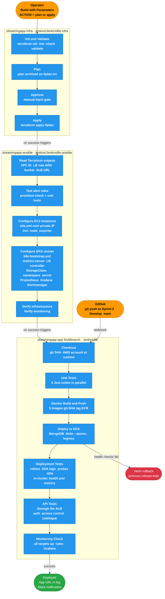
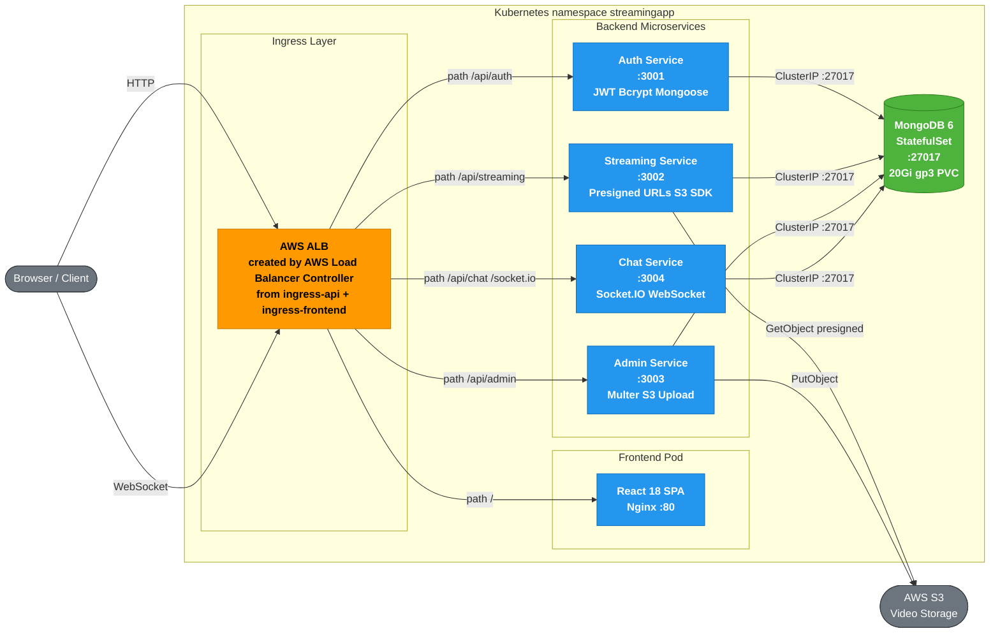
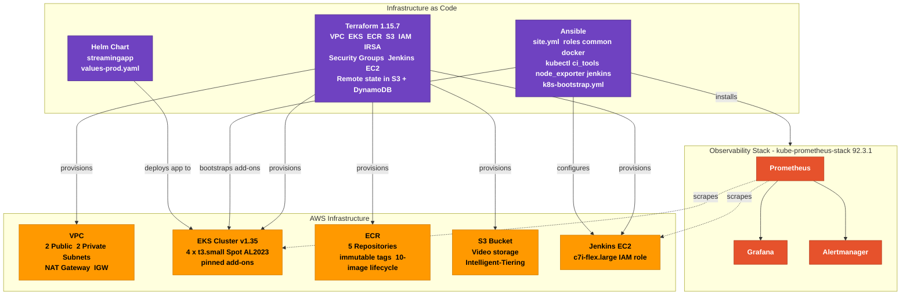

# StreamingApp

> Stream premium video content, host live watch parties, and manage your catalogue with a modern microservices architecture. The platform ships with a production-ready admin portal, real-time chat, S3-backed streaming, and a cinematic React frontend — deployed on AWS EKS via a fully automated Jenkins CI/CD pipeline.

> **Deploying?** Follow the step-by-step [Execution Runbook](docs/RUNBOOK.md): local Docker validation → Terraform → Ansible → Jenkins setup → CI/CD to EKS, with verification and troubleshooting.

---

## Table of Contents

- [Microservices Overview](#microservices-overview)
- [Architecture Diagrams](#architecture-diagrams)
  - [System Architecture](#system-architecture)
  - [CI/CD Pipeline](#cicd-pipeline)
  - [Microservices & Network Flow](#microservices--network-flow)
  - [Infrastructure Overview](#infrastructure-overview)
- [Tech Stack](#tech-stack)
- [Environment Configuration](#environment-configuration)
- [Running Locally with Docker Compose](#running-locally-with-docker-compose)
- [Local Development](#local-development)
- [Kubernetes Deployment (AWS EKS)](#kubernetes-deployment-aws-eks)
- [Helm Chart](#helm-chart)
- [Terraform — AWS Infrastructure](#terraform--aws-infrastructure)
- [Ansible — Configuration Management](#ansible--configuration-management)
- [Jenkins CI/CD Pipeline](#jenkins-cicd-pipeline)
- [Monitoring — Prometheus & Grafana](#monitoring--prometheus--grafana)
- [Testing](#testing)
- [Feature Highlights](#feature-highlights)
- [Deployment Progress](#deployment-progress)
- [Sprint 3 and 4 Progress](#sprint-3-and-4-progress)
- [Sprint 5 and 6 Progress](#sprint-5-and-6-progress)
- [Repository Structure](#repository-structure)
- [License](#license)

---

## Microservices Overview

| Service | Port | Technology | Responsibility |
|---|---|---|---|
| `frontend` | 80 (Nginx) | React 18 + MUI | SPA served via Nginx reverse-proxy |
| `authService` | 3001 | Node.js/Express + Mongoose | User registration, login, JWT, password reset |
| `streamingService` | 3002 | Node.js/Express + AWS S3 | Video catalogue, presigned URLs, playback |
| `adminService` | 3003 | Node.js/Express + Multer + S3 | Video upload/management by admin roles |
| `chatService` | 3004 | Node.js/Express + Socket.IO | Real-time WebSocket chat during streams |
| `mongo` | 27017 | MongoDB 6 | Shared database (one DB per service namespace) |

All backend services share common database models via `backend/common`. Each service is independently deployable, scalable, and communicates via REST APIs and WebSockets.

---

## Architecture Diagrams

### 1. System Architecture (AWS Production)

```mermaid
graph TB
    User([User / Browser])

    subgraph AWS[AWS Cloud  us-east-1]
        subgraph VPC[VPC  10.0.0.0/16]

            subgraph PUBLIC[Public Subnets  AZ-a and AZ-b]
                ALB[Application Load Balancer\nHTTP 80  path-based rules]
                JENKINS[Jenkins EC2\nc7i-flex.large  Ubuntu 22.04\nIAM role  Elastic IP]
                NAT[NAT Gateway]
            end

            subgraph PRIVATE[Private Subnets  EKS Worker Nodes  4 x t3.small Spot]
                subgraph EKS[AWS EKS Cluster  v1.35]
                    LBC[AWS Load Balancer Controller\nmetrics-server  EBS CSI driver]

                    subgraph APP[namespace  streamingapp]
                        FE[Frontend\nReact 18 + Nginx  :80]
                        AUTH[Auth Service\nNode.js  :3001]
                        STREAM[Streaming Service\nNode.js  :3002]
                        ADMIN[Admin Service\nNode.js  :3003]
                        CHAT[Chat Service\nSocket.IO  :3004]
                        MONGO[(MongoDB 6\nStatefulSet  :27017\n20Gi gp3 encrypted)]
                        SECRET[K8s Secret\nstreamingapp-secrets]
                    end

                    subgraph MON[namespace  monitoring  kube-prometheus-stack]
                        PROM[Prometheus\nnode-exporter  kube-state-metrics\n5Gi gp3  3-day retention]
                        GRAF[Grafana\n2 dashboards from code]
                        ALERTMGR[Alertmanager]
                    end
                end
            end
        end

        ECR[AWS ECR\n5 repositories\nimmutable git-SHA tags]
        S3[AWS S3\nstreamingapp-videos]
        TFSTATE[S3 + DynamoDB\nTerraform Remote State]
    end

    GH([GitHub\nwebhook on push])
    SLACK([Slack\n#devops-alerts\nalerts + Jenkins notifications])

    User -->|HTTP| ALB
    User -->|WebSocket| ALB
    LBC -.->|creates from Ingress| ALB
    ALB -->|/| FE
    ALB -->|/api/auth| AUTH
    ALB -->|/api/streaming| STREAM
    ALB -->|/api/admin| ADMIN
    ALB -->|/api/chat  /socket.io| CHAT

    AUTH --> MONGO
    STREAM --> MONGO
    ADMIN --> MONGO
    CHAT --> MONGO
    SECRET -.->|envFrom| AUTH

    STREAM -->|presigned URL| S3
    ADMIN -->|PutObject| S3

    PROM -.->|scrape /metrics| APP
    PROM -.->|scrape :8080/prometheus  :9100| JENKINS
    PROM -.-> ALERTMGR
    ALERTMGR -.->|alert| SLACK
    GRAF -.->|query| PROM

    GH -->|webhook| JENKINS
    JENKINS -.->|build notifications| SLACK
    JENKINS -->|docker push| ECR
    JENKINS -->|helm upgrade  private API endpoint| EKS
    JENKINS -->|terraform apply| VPC
    JENKINS --> TFSTATE
    ECR -->|imagePull via NAT| APP

    classDef aws fill:#FF9900,stroke:#FF6600,color:#000,font-weight:bold
    classDef eks fill:#326CE5,stroke:#1a4fa0,color:#fff,font-weight:bold
    classDef service fill:#2496ED,stroke:#0d6ebd,color:#fff
    classDef db fill:#4DB33D,stroke:#2e7d1f,color:#fff,font-weight:bold
    classDef mon fill:#E6522C,stroke:#b33d1e,color:#fff
    classDef external fill:#6c757d,stroke:#495057,color:#fff
    classDef user fill:#17a2b8,stroke:#117a8b,color:#fff,font-weight:bold

    class ALB,NAT,ECR,S3,TFSTATE aws
    class EKS,LBC,SECRET eks
    class FE,AUTH,STREAM,ADMIN,CHAT service
    class MONGO db
    class PROM,GRAF,ALERTMGR mon
    class JENKINS,SLACK,GH external
    class User user
```



---

### 2. CI/CD Pipeline

Three Jenkins jobs: infrastructure and configuration run on demand (with an approval gate), the application pipeline runs on every push.



---

### 3. Microservices Network Flow



---

### 4. Infrastructure & Observability Overview



---

## Tech Stack

| Layer | Technology |
|---|---|
| **Frontend** | React 18, MUI, Nginx 1.27 |
| **Backend** | Node.js 18, Express, Mongoose, Socket.IO, Multer |
| **Database** | MongoDB 6 (StatefulSet on EKS, encrypted gp3 volume) |
| **Container Registry** | AWS ECR (5 repositories, immutable git-SHA tags) |
| **Orchestration** | AWS EKS 1.35 (4 × t3.small Spot nodes, AL2023), HPA + metrics-server |
| **Ingress** | AWS Application Load Balancer via the AWS Load Balancer Controller |
| **CI/CD** | Jenkins on EC2 (c7i-flex.large, IAM role), 3 pipeline jobs, GitHub webhook |
| **Testing** | Jest (4 backend services), React Testing Library (frontend) |
| **Infrastructure as Code** | Terraform 1.15.7 (pinned; AWS provider ~> 5.0) |
| **Configuration Management** | Ansible 10.7 + AWS EC2 dynamic inventory, `kubernetes.core` |
| **Packaging** | Helm 3 |
| **Object Storage** | AWS S3 + CloudFront CDN (optional) |
| **Secrets** | Kubernetes Secret built at deploy time from Jenkins credentials; no secrets in code |
| **Monitoring** | kube-prometheus-stack: Prometheus, Alertmanager (→ Slack), Grafana, node-exporter, kube-state-metrics; `prom-client` app metrics; Jenkins Prometheus metrics plugin |
| **Notifications** | Slack (#devops-alerts) — pipeline step present, credential not configured yet |

---

## Environment Configuration

Create a `.env` file for each service before running locally. All backend services accept standard AWS credentials for S3 access.

### Auth Service — `backend/authService/.env`

```ini
PORT=3001
MONGO_URI=mongodb://localhost:27017/streamingapp
JWT_SECRET=changeme
CLIENT_URLS=http://localhost:3000
AWS_ACCESS_KEY_ID=
AWS_SECRET_ACCESS_KEY=
AWS_REGION=us-east-1
AWS_S3_BUCKET=
```

### Streaming Service — `backend/streamingService/.env`

```ini
PORT=3002
MONGO_URI=mongodb://localhost:27017/streamingapp
JWT_SECRET=changeme
CLIENT_URLS=http://localhost:3000
AWS_ACCESS_KEY_ID=
AWS_SECRET_ACCESS_KEY=
AWS_REGION=us-east-1
AWS_S3_BUCKET=
AWS_CDN_URL=
STREAMING_PUBLIC_URL=http://localhost:3002
```

### Admin Service — `backend/adminService/.env`

```ini
PORT=3003
MONGO_URI=mongodb://localhost:27017/streamingapp
JWT_SECRET=changeme
CLIENT_URLS=http://localhost:3000
AWS_ACCESS_KEY_ID=
AWS_SECRET_ACCESS_KEY=
AWS_REGION=us-east-1
AWS_S3_BUCKET=
```

### Chat Service — `backend/chatService/.env`

```ini
PORT=3004
MONGO_URI=mongodb://localhost:27017/streamingapp
JWT_SECRET=changeme
CLIENT_URLS=http://localhost:3000
```

### Frontend — `frontend/.env`

```ini
REACT_APP_AUTH_API_URL=http://localhost:3001/api
REACT_APP_STREAMING_API_URL=http://localhost:3002/api
REACT_APP_STREAMING_PUBLIC_URL=http://localhost:3002
REACT_APP_ADMIN_API_URL=http://localhost:3003/api/admin
REACT_APP_CHAT_API_URL=http://localhost:3004/api/chat
REACT_APP_CHAT_SOCKET_URL=http://localhost:3004
```

---

## Running Locally with Docker Compose

```bash
# 1. Copy and populate env files for each service (see above)

# 2. Build and start the full stack
docker-compose up --build

# 3. Open the app
open http://localhost:3000
```

The compose file provisions MongoDB plus all four Node.js microservices. S3 credentials are optional for local testing — you can browse seeded metadata, but streaming requires valid S3 objects.

---

## Local Development

Install dependencies for each service and run them in separate terminals after starting MongoDB:

```bash
# Auth Service
cd backend/authService && npm install && npm run dev

# Streaming Service
cd backend/streamingService && npm install && npm run dev

# Admin Service
cd backend/adminService && npm install && npm run dev

# Chat Service
cd backend/chatService && npm install && npm run dev

# Frontend
cd frontend && npm install && npm start
```

---

## Kubernetes Deployment (AWS EKS)

Deployment is automated by Jenkins (`Jenkinsfile`, Deploy stage). Cluster-level setup — metrics-server, the AWS Load Balancer Controller, the default `gp3` StorageClass, the namespace and the app secret — is done by `ansible/k8s-bootstrap.yml`; the five services come from the Helm chart; `k8s/` holds the namespace, StorageClass, MongoDB and Ingress manifests. The equivalent manual steps:

```bash
# 1. Configure kubectl
aws eks update-kubeconfig --name streamingapp-cluster --region us-east-1

# 2. Default StorageClass (EKS 1.30+ has none), namespace, MongoDB StatefulSet
kubectl apply -f k8s/storageclass.yaml
kubectl apply -f k8s/namespace.yaml
kubectl apply -f k8s/mongo-statefulset.yaml

# 3. All five services (registry and tag are required - no account ID in code, no 'latest')
ACCOUNT_ID=$(aws sts get-caller-identity --query Account --output text)
helm upgrade --install streamingapp ./helm/streamingapp -n streamingapp \
  -f helm/values-prod.yaml \
  --set global.imageRegistry=$ACCOUNT_ID.dkr.ecr.us-east-1.amazonaws.com \
  --set global.imageTag=<GIT_SHA> --atomic --wait

# 4. Ingress (ALB, requires the AWS Load Balancer Controller)
kubectl apply -f k8s/ingress-api.yaml -f k8s/ingress-frontend.yaml
```

### HPA Scaling Targets

| Service | Min Replicas | Max Replicas | CPU Trigger |
|---|---|---|---|
| `auth-service` | 1 | 6 | 70% |
| `streaming-service` | 1 | 10 (prod) | 60% |
| `chat-service` | 1 | 6 | 70% |

`frontend` and `admin-service` run 1 fixed replica. Services start at 1 replica to fit four `t3.small` nodes (11 pods each; cluster add-ons and the monitoring stack take ~28 of the 44 pod slots); the HPAs scale them up under load. All pods have liveness/readiness probes (`/api/health`, frontend `/health`) and roll out with `maxUnavailable: 0`.

---

## Helm Chart

A single parameterised Helm chart (`helm/streamingapp/`) renders a Deployment, Service and (where configured) HorizontalPodAutoscaler for each of the five services.

```bash
ACCOUNT_ID=$(aws sts get-caller-identity --query Account --output text)
helm upgrade --install streamingapp ./helm/streamingapp \
  --namespace streamingapp \
  -f helm/values-prod.yaml \
  --set global.imageRegistry=$ACCOUNT_ID.dkr.ecr.us-east-1.amazonaws.com \
  --set global.imageTag=<GIT_SHA> \
  --atomic --wait --timeout 10m
```

- `global.imageRegistry` and `global.imageTag` have **no defaults**: the chart fails to render without them, and rejects `imageTag=latest`. Jenkins passes the registry (account ID resolved at runtime) and the git SHA.
- `--atomic` rolls back automatically if the new pods fail their health checks.
- When an HPA manages a service, the chart omits `replicas` so Helm upgrades do not reset the scaled replica count.
- `helm/values-prod.yaml` holds production overrides (currently a higher `maxReplicas` for the streaming service).

---

## Terraform — AWS Infrastructure

All AWS resources are managed as code in the `terraform/` directory. Remote state is stored in S3 (`streamingapp-tfstate`) with DynamoDB locking (`streamingapp-tflock`); the backend is configured in `provider.tf`. Terraform is pinned to **1.15.7** — the laptop and the Jenkins server must run the same version to share the state.

```bash
cd terraform
export TF_VAR_admin_cidr="$(curl -s https://checkip.amazonaws.com)/32"   # required, no default
terraform init
terraform plan -out tfplan
terraform apply tfplan
```

In CI the same steps run in the `streamingapp-infra` Jenkins job (plan → manual approval → apply), with `admin_cidr` taken from the `admin-cidr` credential.

### Resources Provisioned

| File | Resources |
|---|---|
| `vpc.tf` | VPC `10.0.0.0/16`, 2 public + 2 private subnets, IGW, single NAT Gateway, ALB subnet tags |
| `eks.tf` | EKS 1.35 cluster; managed node group (4 × t3.small Spot, AL2023); pinned add-ons (CoreDNS, kube-proxy, VPC CNI, EBS CSI); public API endpoint limited to `admin_cidr`, private endpoint for Jenkins; explicit cluster/KMS admins (admin IAM user + Jenkins role) |
| `ec2.tf` | Jenkins EC2 (c7i-flex.large, pinned Ubuntu 22.04 AMI, 30 GB gp3), Elastic IP, key pair |
| `ecr.tf` | 5 ECR repositories, **immutable** tags, scan on push, keep-last-10 lifecycle policy |
| `s3.tf` | Video bucket with versioning, encryption, public access block, Intelligent-Tiering |
| `iam.tf` | Node S3 policy; Jenkins EC2 role + instance profile; IRSA roles for the AWS Load Balancer Controller and EBS CSI driver |
| `security.tf` | Jenkins SG: SSH and UI from `admin_cidr`, UI from GitHub webhook ranges, SSH from inside the VPC |
| `variables.tf` | Inputs; `admin_cidr` has no default and must be a `/32`; versions (EKS, add-ons, AMI) are pinned and validated |

---

## Ansible — Configuration Management

Two playbooks, both run by the `streamingapp-ansible` Jenkins job (triggered automatically after a Terraform apply):

| Playbook | Targets | Purpose |
|---|---|---|
| `site.yml` | EC2 hosts found by the AWS dynamic inventory (tag `Role`) | Configure the Jenkins server and its build tools |
| `k8s-bootstrap.yml` | `localhost` (Jenkins, via its IAM role) | Configure the EKS cluster: metrics-server, AWS Load Balancer Controller, default gp3 StorageClass, namespace, app secret; restarts the app only when the secret changes |

```bash
cd ansible

# From a laptop (public IPs, key from ~/.ssh)
ansible-playbook -i inventory/aws_ec2.yml site.yml

# From Jenkins (private IPs, key from the Jenkins credential; never reconfigures Jenkins itself)
ansible-playbook -i inventory-jenkins/aws_ec2.yml site.yml --private-key "$SSH_KEY" --skip-tags jenkins
```

### Roles

All versions are pinned in each role's `defaults/main.yml`.

| Role | Installs |
|---|---|
| `common` | apt cache, NTP, swap disabled; full package upgrade only on request (`-e upgrade_packages=true`) |
| `docker` | Docker CE, adds the `jenkins` user to the `docker` group |
| `kubectl` | kubectl v1.35.0 (checksum-verified), Helm v3.16.4, AWS CLI v2, Terraform 1.15.7 |
| `ci_tools` | Node.js 20 (unit tests), Ansible 10.7.0 with boto3/botocore/kubernetes |
| `node_exporter` | Prometheus node_exporter 1.12.1 (checksum-verified) on :9100, scraped from EKS — Jenkins host CPU/memory/disk |
| `jenkins` | Java 21, Jenkins LTS (package held so upgrades never restart it mid-pipeline) |

---

## Jenkins CI/CD Pipeline

Three jobs, each defined in the repository:

| Job | Type | Definition | Trigger |
|---|---|---|---|
| `streamingapp-infra` | Pipeline (parameter `ACTION`: plan / apply) | `jenkins/Jenkinsfile.infra` | Manual |
| `streamingapp-ansible` | Pipeline (optional `APP_URL`, `TRIGGER_APP_DEPLOY`, `APP_BRANCH`) | `jenkins/Jenkinsfile.ansible` | Automatically after a successful infra apply, or manual |
| `streamingapp-app` | Multibranch Pipeline | `Jenkinsfile` | GitHub webhook on push, or automatically after a successful Ansible run |

Trigger chain: **code push → build → deploy → tests** (webhook) and **infra apply → configuration + monitoring → app deploy → tests** (job triggers).

**`streamingapp-app` stages** (every branch builds and pushes; deploy and post-deploy tests run on `Sprint-3`, `Develop` and `main`):

| Stage | Action |
|---|---|
| **1 — Checkout** | Clone the commit; resolve the git SHA (image tag) and AWS account ID at runtime |
| **2 — Unit Tests** | `npm ci && npm test` for auth, streaming, admin, chat and frontend in parallel |
| **3 — Docker Build & Push** | Build 5 images tagged with the git SHA and push to ECR; skip images already pushed for that SHA |
| **4 — Deploy to EKS** | Apply MongoDB, `helm upgrade --install --atomic` (incl. ServiceMonitors), apply the Ingress; on a new cluster set the CORS origin from the ALB and restart the pods |
| **5 — Deployment Tests** | [`tests/deployment/verify-deployment.sh`](tests/deployment/verify-deployment.sh): rollouts, image tag = this commit, probes, HPAs, `/api/health` and `/metrics` of every backend from inside the cluster |
| **6 — API Tests** | [`tests/api/api-tests.sh`](tests/api/api-tests.sh): through the ALB — register, login, JWT verify, admin/chat access control, video catalogue, SPA |
| **7 — Monitoring Check** | [`tests/monitoring/verify-monitoring.sh --with-app`](tests/monitoring/verify-monitoring.sh): Prometheus scrapes the new pods, nodes and Jenkins; alert rules, Alertmanager and Grafana healthy |
| **Post** | Slack notification on success/failure, Docker image prune, workspace cleanup |

**`streamingapp-infra` stages:** Init & Validate (`terraform fmt -check`, `validate`) → Plan (archived as `tfplan.txt`) → Approve (manual) → Apply → trigger `streamingapp-ansible`. Slack message on failure.

**`streamingapp-ansible` stages:** Read Terraform outputs (and the ALB URL) → Test alert rules (promtool) → Configure EC2 instances → Configure EKS cluster (incl. monitoring stack) → Verify infrastructure → Verify monitoring → trigger `streamingapp-app/Sprint-3`. Slack message on failure.

### Jenkins Plugins

Pipeline, Pipeline Utility Steps, Git, GitHub, GitHub Branch Source, Docker, Docker Pipeline, Kubernetes CLI, AWS Credentials, Pipeline: AWS Steps, Credentials Binding, SSH Agent, Timestamper, Workspace Cleanup, Slack Notification, Prometheus metrics.

### Jenkins Credentials Required

| Credential ID | Type | Used For |
|---|---|---|
| `github-token` | Username + PAT | Repository checkout / multibranch scans |
| `streamingapp-ssh-key` | SSH username + private key | Ansible SSH to EC2 |
| `jwt-secret` | Secret text | App secret created by `ansible/k8s-bootstrap.yml` |
| `admin-cidr` | Secret text | `TF_VAR_admin_cidr` for the Terraform job (no default in code) |
| `slack-bot-token` | Secret text | Slack Notification plugin (`slackSend` in all three pipelines) |
| `slack-webhook-url` | Secret text | Alertmanager → Slack, stored as the `alertmanager-slack` Secret by Ansible |
| `grafana-admin-password` | Secret text | Grafana `admin` login, stored as the `grafana-admin` Secret by Ansible |

AWS access uses the Jenkins EC2 IAM role (`streamingapp-jenkins-role`); no AWS keys or account IDs are stored in Jenkins or in code. The account ID is resolved at runtime with `aws sts get-caller-identity`.

---

## Monitoring — Prometheus & Grafana

`kube-prometheus-stack` (chart **92.3.1**, pinned) runs in the `monitoring` namespace. [`ansible/k8s-bootstrap.yml`](ansible/k8s-bootstrap.yml) installs it with [`k8s/monitoring/kube-prometheus-stack-values.yaml`](k8s/monitoring/kube-prometheus-stack-values.yaml), applies the alert rules and loads the dashboards. Secrets (Grafana password, Slack webhook) come from Jenkins credentials.

| What is monitored | How |
|---|---|
| Application (4 Node.js services) | `prom-client` at `GET /metrics` ([`util/metrics.js`](backend/authService/util/metrics.js)): request rate, 5xx, latency histogram per route, Node.js CPU/heap/event loop. Scraped through one ServiceMonitor per service ([`servicemonitor.yaml`](helm/streamingapp/templates/servicemonitor.yaml)). `/metrics` is not routed by the ALB |
| Pods, deployments, HPAs | kube-state-metrics, cAdvisor (kubelet) |
| EKS nodes | node-exporter DaemonSet |
| Jenkins jobs | Jenkins **Prometheus metrics** plugin at `http://<jenkins-private-ip>:8080/prometheus/` |
| Jenkins host | node_exporter (Ansible role) on `:9100` |

Jenkins ports 8080/9100 are open to the EKS private subnets only ([`terraform/security.tf`](terraform/security.tf)). Grafana, Prometheus and Alertmanager get no load balancer (cost and exposure); open them with `kubectl port-forward` ([Runbook Phase 10](docs/RUNBOOK.md#phase-10--monitoring-and-alerting-sprint-5)).

**Dashboards** (provisioned from [`k8s/monitoring/dashboards/`](k8s/monitoring/dashboards)): *StreamingApp - Application* (RED metrics per service, pod CPU/memory, HPA replicas, restarts, Node.js runtime, node resources) and *StreamingApp - Jenkins CI/CD* (last result and duration per job, executors and queue, Jenkins host CPU/memory/disk), plus the chart's built-in Kubernetes and node dashboards.

### Alert rules

[`k8s/monitoring/alert-rules.yaml`](k8s/monitoring/alert-rules.yaml), routed by Alertmanager to Slack `#devops-alerts` (firing and resolved). Unit-tested with `promtool` ([`tests/monitoring/alert-rules.test.yml`](tests/monitoring/alert-rules.test.yml)).

| Alert | Condition | Severity |
|---|---|---|
| `AppServiceDown` | Deployment has 0 available pods for 1 min | Critical |
| `MongoDBDown` | MongoDB StatefulSet not ready for 2 min | Critical |
| `AppMetricsTargetDown` | A pod's `/metrics` not scrapeable for 2 min | Warning |
| `AppHighErrorRate` | > 5% of a service's requests return 5xx for 5 min | Warning |
| `AppHighLatency` | p95 latency > 1 s for 10 min | Warning |
| `AppPodRestarting` | > 3 restarts in 15 min | Warning |
| `HostHighCPU` / `HostHighMemory` | > 85% CPU / > 90% memory for 10 min (EKS nodes and Jenkins host) | Warning |
| `HostDiskAlmostFull` | < 15% root disk free for 10 min | Critical |
| `JenkinsDown` | Jenkins metrics endpoint unreachable for 2 min | Critical |
| `JenkinsJobFailed` | Last build of a `streamingapp-*` job failed | Warning |
| `JenkinsBuildQueueStuck` | > 3 queued builds for 15 min | Warning |

The chart's default Kubernetes rules (crash loops, HPA maxed out, volumes filling up, …) stay enabled. Rules for components EKS manages (etcd, scheduler, controller-manager, kube-proxy) are switched off because they cannot be scraped.

**Jenkins notifications:** every pipeline posts to Slack on failure (the app pipeline also on success). Failed deployments are rolled back by Helm `--atomic`, and the message says so.

---

## Testing

| Level | What | Where | Runs in |
|---|---|---|---|
| Unit | Auth (JWT, health), streaming, admin auth, chat auth, frontend, metrics middleware (all 4 services) | `backend/*/__tests__/`, `frontend/src/App.test.js` | App pipeline *Unit Tests*, every branch |
| Alert rules | `promtool check rules` + 5 unit tests (alerts fire / stay quiet as expected) | [`tests/monitoring/`](tests/monitoring) | Ansible pipeline *Test alert rules* |
| Infrastructure integrity | EKS, add-ons, nodes, subnets/NAT, security groups, Jenkins role, S3 security, state backend, ECR settings, cluster bootstrap | [`tests/infra/verify-infra.sh`](tests/infra/verify-infra.sh) | Ansible pipeline *Verify infrastructure* |
| Deployment success | Rollouts, image tag = commit SHA, probes, HPAs, in-cluster health and metrics, ServiceMonitors | [`tests/deployment/verify-deployment.sh`](tests/deployment/verify-deployment.sh) | App pipeline *Deployment Tests* |
| Application functionality | Register/login/JWT, access control (401/403), catalogue via MongoDB, SPA — through the ALB | [`tests/api/api-tests.sh`](tests/api/api-tests.sh) | App pipeline *API Tests* |
| Monitoring | Components up, all scrape targets up, rules loaded, Alertmanager → Slack, Grafana and dashboards | [`tests/monitoring/verify-monitoring.sh`](tests/monitoring/verify-monitoring.sh) | Both pipelines |

How to run each one by hand: [`tests/README.md`](tests/README.md).

---

## Feature Highlights

- **S3-backed streaming** with secure presigned uploads for admins and presigned playback URLs for users.
- **Dedicated admin microservice** for video ingestion, metadata management, and featured curation.
- **Real-time chat** overlay in the player using Socket.IO with persistent message history.
- **Modern React experience** featuring cinematic hero sections, dynamic carousels, and responsive design.
- **Role-aware access control** across frontend routes and all backend microservices.
- **Horizontal Pod Autoscaling** on Auth, Streaming, and Chat services based on CPU utilisation.
- **Zero-downtime deployments** via RollingUpdate strategy (`maxUnavailable: 0`), with automatic Helm rollback when health checks fail.
- **Fully automated delivery**: a `git push` runs tests, builds and pushes images, deploys to EKS and runs deployment, API and monitoring tests; an infrastructure apply chains configuration, monitoring and deployment automatically.
- **Reproducible, pinned infrastructure**: Terraform, Ansible, add-on, chart and image versions are all pinned; no secrets, account IDs or open CIDRs in code.
- **Observability** with Prometheus, Grafana dashboards and Slack alerting for the app, the cluster and Jenkins.

---

## Deployment Progress

Full status log lives in [`docs/Sprint 2 progress.docx`](docs/Sprint%202%20progress.docx) (with a slide summary in [`docs/Sprint 2 Progress - App Live.pptx`](docs/Sprint%202%20Progress%20-%20App%20Live.pptx)). Progress below tracks the path from provisioning through confirming the application is live on real AWS infrastructure — not a local demo.

- [x] **AWS Identity & CLI Setup** — dedicated IAM user created for programmatic Terraform/CLI access; AWS CLI configured and verified
- [x] **Terraform Backend Bootstrap** — `streamingapp-tfstate` S3 bucket (remote state) and `streamingapp-tflock` DynamoDB table (state locking) created and bootstrapped ahead of the main config, then `terraform init` re-run against the new backend
- [x] **Networking** — VPC created; 2 public + 2 private subnets; 1 NAT Gateway; 1 Internet Gateway; public and private route tables configured
- [x] **Compute, Registry & Storage** — EKS cluster provisioned with node group and worker nodes; Jenkins EC2 instance up; ECR repositories created with images pushed; S3 and DynamoDB resources provisioned
- [x] **Kubernetes RBAC for Terraform** — Terraform identity granted RBAC access on the EKS cluster so kubectl/Helm can authenticate against it
- [x] **Ansible Configuration of Jenkins EC2** — new SSH key pair generated and wired into `EC2.tf`; key copied into WSL's native filesystem; Ansible playbook run against the dynamic AWS inventory over real SSH, zero failures
- [x] **Docker Image Build & Push to ECR** — `frontend`, `auth-service`, `streaming-service`, `admin-service`, and `chat-service` images built and pushed to their ECR repositories
- [x] **Application Deployment via Helm** — real application secret populated; MongoDB and core app components deployed; all 5 services deployed via Helm with the image tag overridden to the versions just pushed; all pods confirmed `Running`
- [x] **Load Balancer, Ingress & Pipeline Test** — AWS Load Balancer Controller installed and Ingress configured for external access; Jenkinsfile run through Jenkins to validate the CI/CD pipeline end to end
- [x] **Result — Application Verified Live** — traffic reaching the app through the Load Balancer and Ingress, confirmed on real AWS infrastructure

---

## Sprint 3 and 4 Progress

Sprint 3 (configuration management with Ansible through Jenkins) and Sprint 4 (CI/CD to EKS) were completed and verified end to end on a freshly provisioned AWS environment on 16 Oct 2026. Screenshots and detail are in [`docs/Sprint-3 progress.docx`](docs/Sprint-3%20progress.docx), with a slide summary in [`docs/Sprint 3 and 4 Progress.pptx`](docs/Sprint%203%20and%204%20Progress.pptx); the step-by-step procedure is in the [Execution Runbook](docs/RUNBOOK.md).

### Pipeline design

| Jenkins job | Definition | Sprint | What it does |
|---|---|---|---|
| `streamingapp-infra` | [`jenkins/Jenkinsfile.infra`](jenkins/Jenkinsfile.infra) | 2 | Terraform init → fmt/validate → plan (archived) → manual approval → apply. A successful apply **triggers `streamingapp-ansible`** |
| `streamingapp-ansible` | [`jenkins/Jenkinsfile.ansible`](jenkins/Jenkinsfile.ansible) | 3 | Reads Terraform outputs; configures EC2 ([`ansible/site.yml`](ansible/site.yml)); bootstraps the cluster ([`ansible/k8s-bootstrap.yml`](ansible/k8s-bootstrap.yml)): metrics-server, AWS Load Balancer Controller, default gp3 StorageClass, namespace, app secret |
| `streamingapp-app` (Multibranch) | [`Jenkinsfile`](Jenkinsfile) | 4 | Triggered by GitHub webhook on push: unit tests (5 suites in parallel) → Docker build → push to ECR (git-SHA tag) → Helm deploy to EKS (`--atomic`) → in-cluster and ALB smoke tests |

### Completed

**Sprint 3 — Configuration management**
- [x] Ansible playbooks configure the Jenkins EC2 host: Docker, kubectl, Helm, AWS CLI, Terraform, Node.js and Ansible, all at pinned versions
- [x] Jenkins Ansible job runs over the private network with the SSH key from Jenkins credentials (`--skip-tags jenkins`, so Jenkins never reconfigures itself mid-job)
- [x] Ansible job **triggered automatically** after the Terraform job (`streamingapp-ansible #1` "Started by upstream project streamingapp-infra #6")
- [x] Cluster bootstrap codified in Ansible (previously manual): metrics-server, AWS Load Balancer Controller (IRSA role from Terraform), default StorageClass, namespace and secret
- [x] Second Ansible run detects the ALB URL, updates `CLIENT_URLS` and restarts the app pods only when the secret changes (idempotent)

**Sprint 4 — CI/CD to EKS**
- [x] Multi-stage pipeline: Checkout → Unit Tests → Docker Build & Push → Deploy to EKS → Smoke Tests
- [x] Real unit tests replace the placeholder `echo` scripts: Jest suites for auth, streaming, admin and chat services plus the frontend (12 tests)
- [x] Images built per commit and pushed to ECR tagged with the git SHA; re-runs of the same commit reuse the existing image
- [x] Helm deploy with liveness/readiness probes, HorizontalPodAutoscalers (CPU-based, via metrics-server) and automatic rollback (`--atomic`)
- [x] ALB Ingress routes `/api/auth`, `/api/streaming`, `/api/admin`, `/api/chat`, `/socket.io` and the SPA
- [x] GitHub webhook → Jenkins: a `git push` starts the build automatically
- [x] **Result:** `streamingapp-app » Sprint-3 #5` passed all stages; services healthy in-cluster and through the ALB

### Review feedback addressed

| Feedback | Change |
|---|---|
| Sensitive values (account IDs, ARNs) hard-coded | Removed `trust-policy.json`, `ebs-trust-policy.json`, `iam_policy.json` and placeholder manifests. IRSA roles are created by Terraform from cluster outputs; the account ID is resolved at runtime (`aws sts get-caller-identity`, `data.aws_caller_identity`); secrets come from Jenkins credentials |
| SSH/admin CIDR defaulting to an open value | `admin_cidr` has **no default** and must be a single `/32` (validation rejects `0.0.0.0/0`). Supplied via `TF_VAR_admin_cidr` / the `admin-cidr` Jenkins credential. The EKS public API endpoint is now restricted to it as well |
| Image tag defaulting to `latest` | Images are tagged only with the git SHA; ECR repositories are **immutable**; the Helm chart refuses an empty or `latest` tag. EKS add-ons, the Jenkins AMI, Helm charts and tools (Terraform 1.15.7, kubectl, Helm, Ansible) are pinned to exact versions |

Other hardening: Jenkins uses an **EC2 IAM role** (no AWS keys stored in Jenkins); work is done with an IAM user instead of root access keys; explicit EKS cluster/KMS administrators; GitHub token removed from the Git remote URL.

### Issues found and resolved during execution

| Issue | Root cause | Resolution |
|---|---|---|
| `RunInstances ... not eligible for Free Tier` | Account is on the AWS Free plan; `t3.medium` not allowed | Jenkins on `c7i-flex.large` (same 2 vCPU / 4 GB, Free Tier eligible) |
| `log group already exists` on apply | CloudWatch log group left over from an earlier cluster | Deleted the empty leftover log group, re-applied |
| EKS 1.33 in extended support | Extended support costs 6× for the control plane | Cluster moved to EKS 1.35 (standard support) with matching add-on versions |
| `bcrypt` build failure in Docker | Prebuilt binary download blocked; Alpine image had no compiler | Multi-stage auth Dockerfile with build tools in the build stage only |
| Jenkins plan wanted to replace the admin access entry | "Cluster creator" admin follows whoever runs Terraform (laptop user vs Jenkins role) | Admins listed explicitly; existing entry renamed in state with `moved` blocks (0 to destroy) |
| `Unable to find jenkins/Jenkinsfile.infra` | Jobs pointed at `Develop`, changes were on `Sprint-3` | Jobs and Jenkinsfile deploy condition switched to `Sprint-3` |
| Deploy timed out, MongoDB PVC `Pending` | EKS 1.30+ has no default StorageClass | Default encrypted `gp3` StorageClass (EBS CSI), created by the Ansible bootstrap |
| Deploy timed out, pods `Too many pods` / `Insufficient memory` | 2 × `t3.small` (11 pods, 2 GB each) full with cluster add-ons | 3 × `t3.small` Spot nodes; services start at 1 replica and scale with HPA |
| `kubectl` blocked on Windows | Smart App Control blocks the unsigned Chocolatey binary | Use the signed Docker Desktop kubectl (PowerShell profile PATH) |

### Teardown

After verification and evidence capture, all AWS resources were deleted to stay within the Free plan credits: Terraform destroy (91 resources), the Kubernetes-created ALB and EBS volume, ECR images, S3 buckets, the Terraform state bucket and lock table, leftover EKS OIDC providers and the `streamingapp-admin` IAM user. The environment can be rebuilt from Phase 2 of the [Execution Runbook](docs/RUNBOOK.md).

---

## Sprint 5 and 6 Progress

Implemented in code; execution steps and the screenshot checklist are in [Runbook Phases 10–11](docs/RUNBOOK.md#phase-10--monitoring-and-alerting-sprint-5).

**Sprint 5 — Monitoring and alerting**
- [x] Prometheus in EKS collecting application (`/metrics` on all 4 backends), pod, node and Jenkins metrics
- [x] Grafana dashboards for application performance and resource health, and for Jenkins jobs, provisioned from code
- [x] Jenkins integrated with Prometheus/Grafana (Prometheus metrics plugin + node_exporter on the Jenkins host)
- [x] 12 alert rules for the application, hosts and Jenkins, routed by Alertmanager to Slack; Jenkins Slack notifications for failed deployments and jobs
- [ ] Executed on AWS with evidence (Runbook Phase 10)

**Sprint 6 — Testing, documentation, final automation**
- [x] Test cases for application functionality, deployment success, infrastructure integrity and monitoring, wired into the pipelines ([Testing](#testing))
- [x] Trigger chain automated end to end: push → build → deploy → test; infra apply → Ansible → app deploy → test
- [x] Manual CORS re-run removed: the app pipeline sets the origin on a new cluster
- [x] Runbook extended with monitoring, testing and troubleshooting
- [ ] Final end-to-end run on AWS with evidence (Runbook Phase 11)

---

## Repository Structure

```
StreamingApp/
├── Jenkinsfile                  # App CI/CD: test → build → ECR → EKS → deployment/API/monitoring tests
├── jenkins/
│   ├── Jenkinsfile.infra        # Terraform plan / approve / apply, then triggers Ansible
│   └── Jenkinsfile.ansible      # Rule tests, EC2 configuration, EKS bootstrap + monitoring, verification
├── docker-compose.yml           # Local development stack
├── frontend/                    # React 18 + Nginx SPA (Dockerfile, nginx.conf)
├── backend/
│   ├── authService/             # JWT auth — :3001 (Jest tests in __tests__/)
│   ├── streamingService/        # Video catalogue — :3002
│   ├── adminService/            # Admin uploads — :3003
│   └── chatService/             # Socket.IO chat — :3004
├── k8s/                         # Manifests applied alongside the Helm chart
│   ├── namespace.yaml
│   ├── storageclass.yaml        # Default encrypted gp3 StorageClass (EBS CSI)
│   ├── mongo-statefulset.yaml
│   ├── ingress-api.yaml         # ALB rules for /api/* and /socket.io
│   ├── ingress-frontend.yaml    # ALB catch-all rule for the SPA
│   └── monitoring/              # kube-prometheus-stack values, alert rules, Grafana dashboards
├── helm/
│   ├── streamingapp/            # Main Helm chart
│   │   ├── Chart.yaml
│   │   ├── values.yaml
│   │   └── templates/           # deployment.yaml, service.yaml, hpa.yaml, servicemonitor.yaml
│   └── values-prod.yaml         # Production overrides
├── terraform/                   # AWS infrastructure as code
│   ├── provider.tf              # Pinned Terraform + S3/DynamoDB backend
│   ├── variables.tf
│   ├── vpc.tf
│   ├── eks.tf
│   ├── ec2.tf                   # Jenkins EC2 + Elastic IP
│   ├── ecr.tf
│   ├── s3.tf
│   ├── iam.tf
│   ├── security.tf
│   ├── outputs.tf
│   └── keys/                    # SSH public key for the Jenkins key pair
├── ansible/                     # Configuration management
│   ├── site.yml                 # EC2 configuration
│   ├── k8s-bootstrap.yml        # EKS add-ons, StorageClass, namespace, secret, monitoring stack
│   ├── ansible.cfg
│   ├── inventory/aws_ec2.yml    # Dynamic inventory (laptop, public IPs)
│   ├── inventory-jenkins/aws_ec2.yml  # Dynamic inventory (Jenkins, private IPs)
│   └── roles/
│       ├── common/
│       ├── docker/
│       ├── kubectl/
│       ├── ci_tools/
│       ├── node_exporter/
│       └── jenkins/
├── tests/                       # Sprint 6: infra, deployment, API and monitoring tests (see tests/README.md)
└── docs/                        # Runbook, sprint progress reports, issues log
```

---

## License

MIT © Apoorva Deshpande
