# StreamingApp: End-to-End DevOps Pipeline on AWS EKS

A video streaming application (React frontend, 4 Node.js microservices, MongoDB) taken from local Docker containers to a fully automated deployment on **AWS EKS**, using **Jenkins, Terraform, Ansible, Helm, Prometheus, Grafana and Slack**. The work was delivered in six sprints.

| Document | Purpose |
|---|---|
| [Execution Runbook](docs/RUNBOOK.md) | Step-by-step commands for every phase, with expected results and troubleshooting |
| [Tests](tests/README.md) | What each test script checks and which pipeline stage runs it |
| [Final presentation](docs/final%20ppt.pptx) | Slide summary of the project |
| [Viva Q&A](docs/Viva-QA.docx) | Design decisions explained |

---

## Contents

- [Architecture](#architecture)
- [Sprint 1: Dockerize and set up Jenkins](#sprint-1-dockerize-and-set-up-jenkins)
- [Sprint 2: Provision AWS with Terraform](#sprint-2-provision-aws-with-terraform)
- [Sprint 3: Configuration management with Ansible](#sprint-3-configuration-management-with-ansible)
- [Sprint 4: CI/CD to EKS](#sprint-4-cicd-to-eks)
- [Sprint 5: Monitoring and alerting](#sprint-5-monitoring-and-alerting)
- [Sprint 6: Testing, documentation and final automation](#sprint-6-testing-documentation-and-final-automation)
- [Security and reproducibility](#security-and-reproducibility)
- [Cost and teardown](#cost-and-teardown)
- [Repository structure](#repository-structure)

---

## Architecture

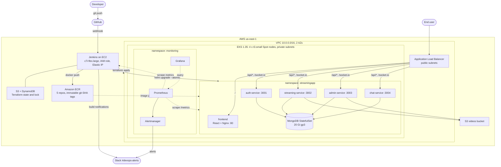

**How it fits together**

- **Code to production:** a `git push` triggers Jenkins through a GitHub webhook. Jenkins tests the code, builds 5 Docker images, pushes them to ECR tagged with the git commit SHA, and deploys them to EKS with Helm.
- **Traffic:** users reach an Application Load Balancer created from the Kubernetes Ingress. It routes `/` to the frontend and `/api/*` and `/socket.io` to the four backend services, which share one MongoDB StatefulSet.
- **Infrastructure and configuration:** Terraform provisions AWS, with its state in S3 and a DynamoDB lock. Ansible configures the Jenkins server and bootstraps the cluster.
- **Observability:** Prometheus scrapes the app, nodes, Kubernetes and Jenkins. Grafana shows the dashboards, and Alertmanager sends alerts to Slack.

### Jenkins pipeline chain

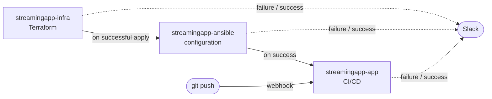

**The application live on EKS, opened through the ALB URL:**


---

## Sprint 1: Dockerize and set up Jenkins

**Goal:** containerise the application and set up a Jenkins server that can access AWS without stored keys.

- Wrote a **Dockerfile for each service**. The frontend uses a **multi-stage build**: Node builds the React app, and only the static files are copied into a small Nginx image. The auth service also uses a multi-stage build so the compiler for `bcrypt` stays out of the final image.
- `docker-compose.yml` runs the whole stack locally (frontend, 4 services, MongoDB) for validation before anything goes to AWS.
- **Jenkins on EC2** (`c7i-flex.large`, 2 vCPU / 4 GB, 30 GB disk, Elastic IP) with the required plugins: Pipeline, Git, Docker, AWS credentials, Slack Notification and Prometheus metrics.
- **AWS access through an EC2 IAM role** (`streamingapp-jenkins-role`). Jenkins stores no AWS access keys, and the account ID is resolved at runtime.
- **Git integration:** a GitHub webhook starts a build on every push.

| Service | Port | Technology |
|---|---|---|
| frontend | 80 | React 18 + Nginx |
| auth-service | 3001 | Node.js / Express, JWT |
| streaming-service | 3002 | Node.js / Express, S3 |
| admin-service | 3003 | Node.js / Express, S3 uploads |
| chat-service | 3004 | Node.js / Socket.IO |
| MongoDB | 27017 | mongo:6 |

**All six containers running locally (`docker compose ps`):**

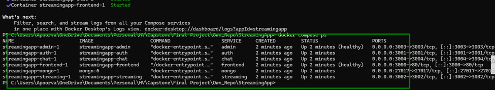

**The three Jenkins jobs on the EC2 server:**

`streamingapp-infra`: Terraform job, successful build

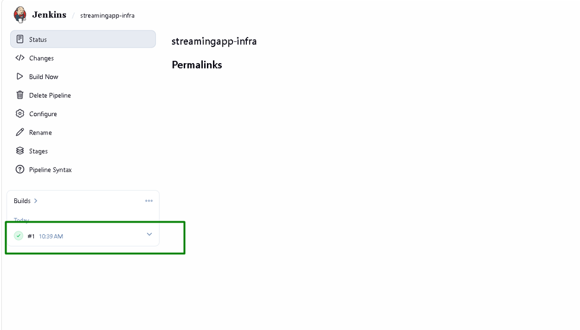

`streamingapp-ansible`: started automatically by the upstream `streamingapp-infra` build

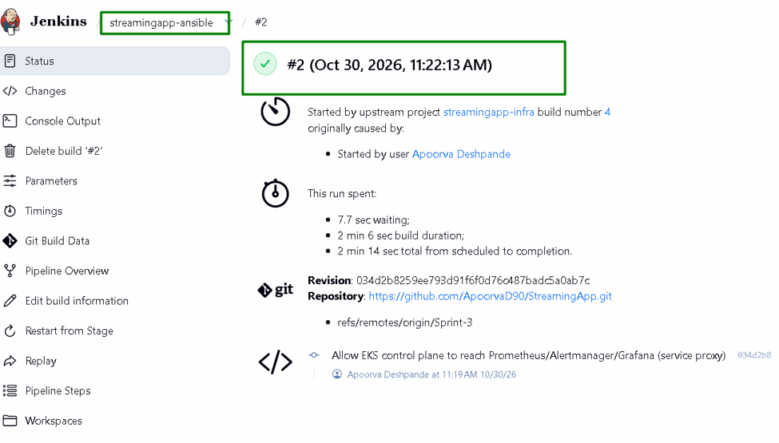

`streamingapp-app` (Multibranch, `Sprint-3` branch): started by a GitHub push event

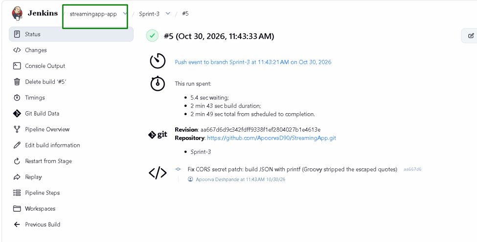

**GitHub webhook to Jenkins (push events), last delivery successful:**

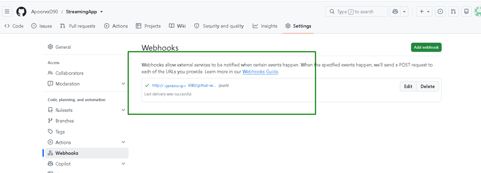

---

## Sprint 2: Provision AWS with Terraform

**Goal:** define all AWS infrastructure as code and run it from a Jenkins job, with remote state.

| Resource | Specification |
|---|---|
| VPC | `10.0.0.0/16` across 2 AZs; 2 public and 2 private `/24` subnets; single NAT gateway |
| EKS cluster | Kubernetes 1.35. The public endpoint is open only to the admin `/32`, and Jenkins uses the private endpoint. Pinned add-ons: coredns, kube-proxy, vpc-cni, EBS CSI |
| Node group | 4 × `t3.small` **Spot**, min 4 / max 6, AL2023, 20 GB disk |
| Jenkins EC2 | `c7i-flex.large`, Ubuntu 22.04, 30 GB, Elastic IP |
| Security group | 22/8080 from the admin `/32` only; 8080 from GitHub webhook ranges; 8080/9100 from private subnets for Prometheus |
| ECR | 5 repositories, **immutable** tags, scan on push, keep the last 10 images |
| S3 | Video bucket: versioned, encrypted, public access blocked |
| IAM | Jenkins EC2 role; IRSA roles for the Load Balancer Controller and EBS CSI driver; EKS access entries |
| Remote state | S3 bucket `streamingapp-tfstate` + DynamoDB lock table |

**Jenkins job `streamingapp-infra`** ([`jenkins/Jenkinsfile.infra`](jenkins/Jenkinsfile.infra)), a parameterised pipeline with `ACTION = plan | apply`:
Init & Validate → Plan (archived as `tfplan.txt`) → **manual Approve** → Apply. A successful apply triggers the Ansible job.

**First `terraform apply` from the laptop: `91 added, 0 changed, 0 destroyed`, with the outputs (ECR repository URLs, EKS endpoint, Jenkins IPs, IAM role ARNs) that the later pipelines consume. Account ID, cluster ID and public IP masked:**

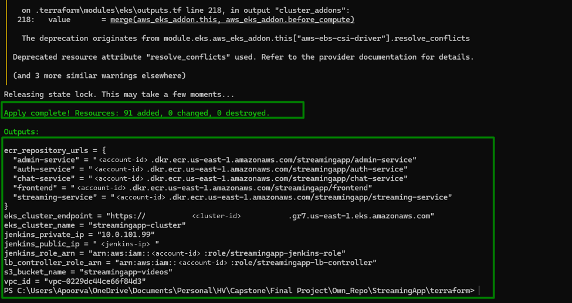

Later runs of the `streamingapp-infra` job on unchanged code report `0 added, 0 changed, 0 destroyed`: Terraform is idempotent, so a re-run only confirms AWS still matches the code (no drift).

**`streamingapp-infra` run: Init & Validate → Plan → Approve → Apply, then Post Actions schedules `streamingapp-ansible`:**

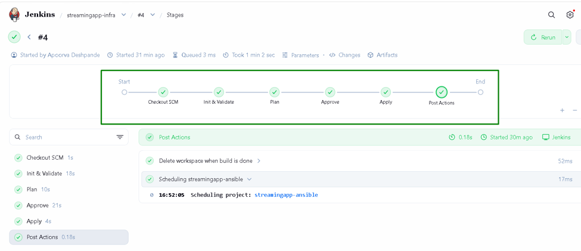

**`kubectl get nodes`: the EKS managed node group's 4 t3.small Spot nodes, spread over both private subnets (`10.0.1.x`, `10.0.2.x`), all `Ready` on Kubernetes v1.35:**

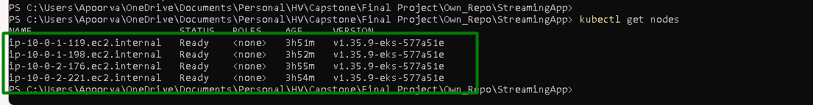

---

## Sprint 3: Configuration management with Ansible

**Goal:** configure servers and the cluster with Ansible, triggered automatically after Terraform.

- **`ansible/site.yml`** configures the Jenkins EC2 host through a **dynamic AWS inventory**. Roles: `common`, `docker`, `kubectl`, `ci_tools` (Helm, Terraform, AWS CLI, Node.js), `node_exporter` and `jenkins`, all at pinned versions.
- **`ansible/k8s-bootstrap.yml`** bootstraps EKS: metrics-server, the AWS Load Balancer Controller, a default gp3 StorageClass, the app namespace and its Secret, and (from Sprint 5) the monitoring stack.
- **Jenkins job `streamingapp-ansible`** ([`jenkins/Jenkinsfile.ansible`](jenkins/Jenkinsfile.ansible)) is **triggered by `streamingapp-infra`** after a successful apply. It reads the Terraform outputs and runs both playbooks with secrets from Jenkins credentials. It skips the `jenkins` role so Jenkins never restarts itself mid-job.
- The playbooks are idempotent: a second run reports no changes unless something actually changed (for example, the ALB URL used for CORS).

**`streamingapp-ansible` started automatically by the upstream `streamingapp-infra` build:**


**`streamingapp-ansible` #3 console: node_exporter installed on the Jenkins host, and `PLAY RECAP` shows `ok=26 changed=1 unreachable=0 failed=0`:**

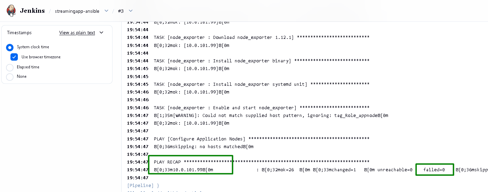

---

## Sprint 4: CI/CD to EKS

**Goal:** a multi-stage pipeline that builds, tests and deploys the app to EKS on every push.

**Jenkins job `streamingapp-app`**, a Multibranch pipeline ([`Jenkinsfile`](Jenkinsfile)):

| # | Stage | What it does |
|---|---|---|
| 1 | Checkout | Gets the code; image tag = 8-character git SHA |
| 2 | Unit Tests | 5 Jest suites in parallel (4 services + frontend) |
| 3 | Docker Build & Push | Builds 5 images and pushes them to ECR; skips a SHA that already exists |
| 4 | Deploy to EKS | MongoDB StatefulSet, `helm upgrade --install --atomic`, Ingress, CORS secret |
| 5–7 | Deployment / API / Monitoring tests | Added in Sprint 6 |
| Post | Notifications | Slack message on success and failure |

Deploy stages run only on `main`, `Develop` and `Sprint-3`. Other branches only test and build.

**Kubernetes deployment (Helm chart [`helm/streamingapp`](helm/streamingapp)):**

| Workload | Requests (CPU / mem) | Limits (CPU / mem) | Scaling |
|---|---|---|---|
| frontend | 50m / 64Mi | 200m / 128Mi | 1 replica |
| auth-service | 100m / 128Mi | 300m / 256Mi | HPA 1–6 at 70% CPU |
| streaming-service | 200m / 256Mi | 500m / 512Mi | HPA 1–10 at 60% CPU |
| admin-service | 100m / 128Mi | 300m / 256Mi | 1 replica |
| chat-service | 100m / 128Mi | 300m / 256Mi | HPA 1–6 at 70% CPU |
| MongoDB | 250m / 512Mi | 500m / 1Gi | 1 replica, 20 Gi gp3 volume |

- **Health checks:** liveness and readiness probes on every service.
- **Safe deploys:** `--atomic` rolls back automatically if the new pods fail their health checks.
- **Autoscaling:** HPAs scale on CPU, using metrics from metrics-server.

**`streamingapp-app` build on `Sprint-3`, started by a GitHub push: every stage green, including the 5 parallel unit test suites, the EKS deploy and the post-deploy tests:**

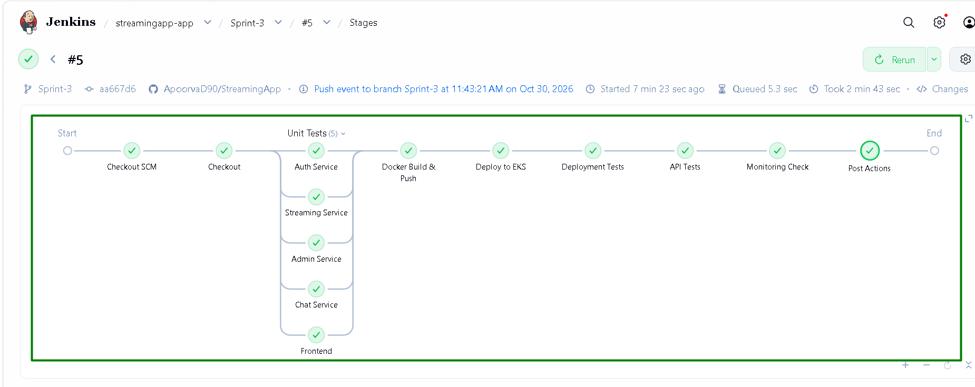

**The five ECR repositories, all with immutable tags and AES-256 encryption:**

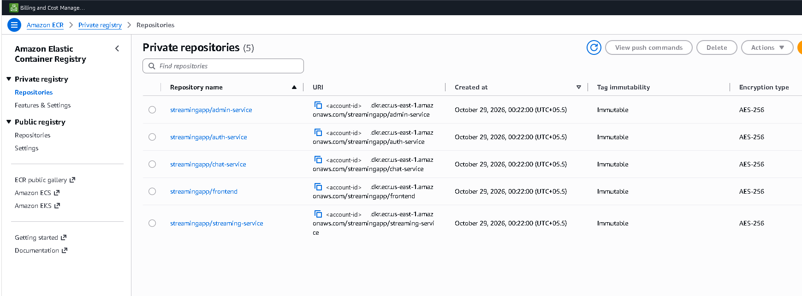

**Pods, Services, HPAs and Ingress in the `streamingapp` namespace (`kubectl get pods,svc,hpa,ingress -n streamingapp`): all 6 pods `1/1 Running` with 0 restarts (`mongo-0` kept running through the latest rollout), every Service internal (`ClusterIP`), 3 HPAs on CPU targets, and both Ingresses sharing one ALB:**

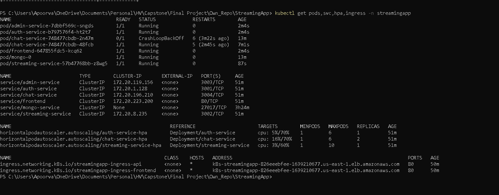

**HPA scaling `auth-service` from 1 to 5 replicas under load: CPU rises to 204% of the 70% target, then falls back as new pods share the load:**

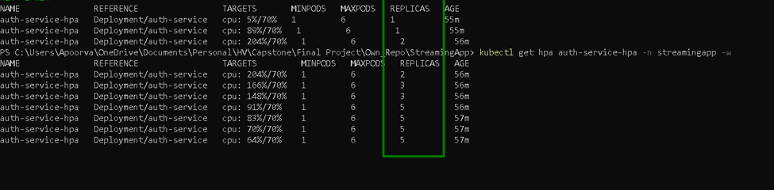

---

## Sprint 5: Monitoring and alerting

**Goal:** collect application, node and Jenkins metrics, show them in Grafana, and alert to Slack.

- **kube-prometheus-stack** (Helm chart 92.3.1, installed by Ansible): Prometheus, Alertmanager, Grafana, node-exporter and kube-state-metrics. Values are in [`k8s/monitoring/kube-prometheus-stack-values.yaml`](k8s/monitoring/kube-prometheus-stack-values.yaml).
- **What is scraped every 30 seconds:** `/metrics` on the 4 backend services (through ServiceMonitors), the nodes, Kubernetes objects, Jenkins (Prometheus plugin) and the Jenkins host (node_exporter on port 9100).
- **Grafana dashboards** for application performance, resource health and Jenkins jobs, provisioned from code as ConfigMaps.
- **Alertmanager → Slack `#devops-alerts`:** alerts are grouped by alert name and namespace, wait 30 s (`group_wait`) and repeat every 4 h. Resolved messages are sent too, and a critical alert suppresses the matching warning.
- **Jenkins Slack notifications** for failed and successful builds.

**Alert rules** ([`k8s/monitoring/alert-rules.yaml`](k8s/monitoring/alert-rules.yaml)):

| Alert | Fires when | For | Severity |
|---|---|---|---|
| AppServiceDown | A deployment has fewer than 1 available replica | 1m | critical |
| MongoDBDown | MongoDB has fewer than 1 ready replica | 2m | critical |
| AppMetricsTargetDown | An app target cannot be scraped | 2m | warning |
| AppHighErrorRate | More than 5% of requests return 5xx | 5m | warning |
| AppHighLatency | p95 latency above 1 s | 10m | warning |
| AppPodRestarting | More than 3 restarts in 15 min | – | warning |
| HostHighCPU | Node CPU above 85% | 10m | warning |
| HostHighMemory | Node memory above 90% | 10m | warning |
| HostDiskAlmostFull | Less than 15% disk free | 10m | critical |
| JenkinsDown | Jenkins metrics unreachable | 2m | critical |
| JenkinsJobFailed | Last build of a job failed | – | warning |
| JenkinsBuildQueueStuck | More than 3 builds queued | 15m | warning |

**Prometheus target health: every scrape target is UP.**

Jenkins (Prometheus plugin), the Jenkins host (node_exporter :9100) and Grafana:

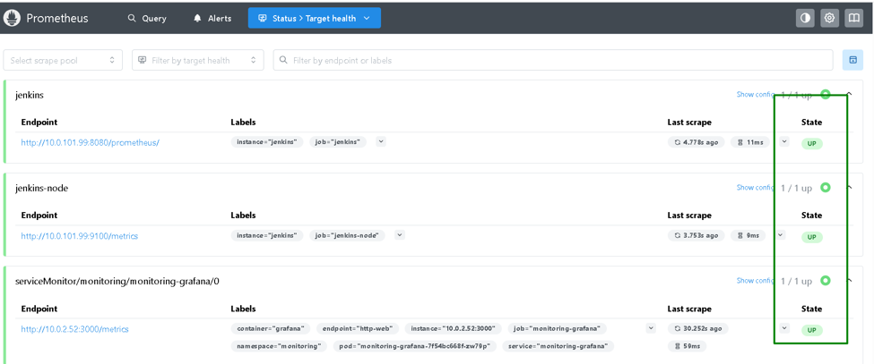

Application services scraped through ServiceMonitors (`/metrics` on admin, auth and chat services):

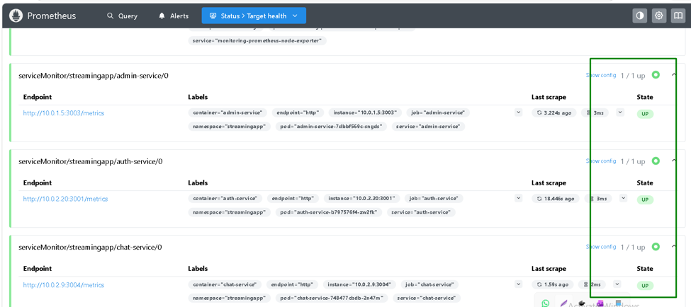

**Grafana "StreamingApp - Application" dashboard, pods and autoscaling: CPU and memory per pod, HPA replicas (current vs max), container restarts, Node.js event loop lag and heap usage:**

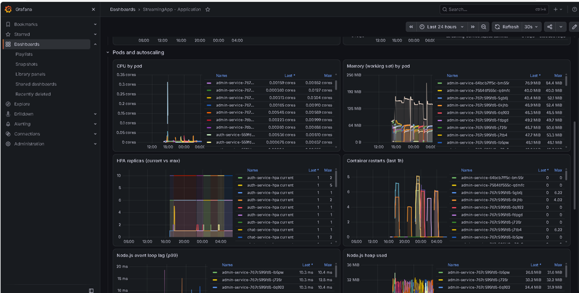

**Grafana "StreamingApp - Jenkins CI/CD" dashboard: last result of each job, build durations, executors and queue, and the Jenkins host's CPU, memory and disk (node_exporter):**

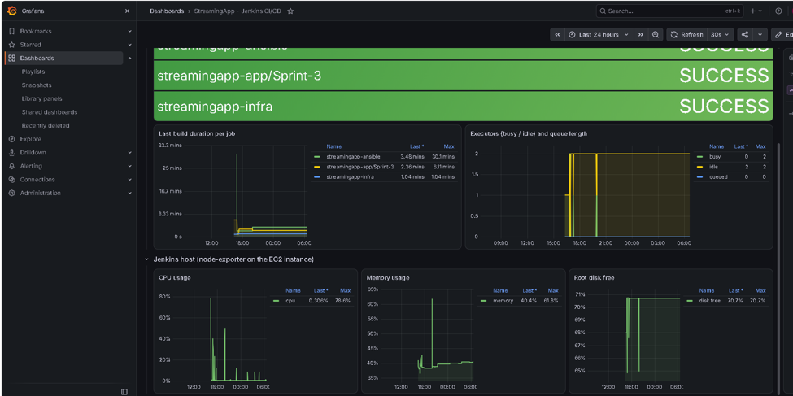

**Alertmanager → Slack `#devops-alerts`, tested by scaling `admin-service` to 0 replicas:**

🚨 `AppServiceDown (critical)` fires after the deployment has had 0 available replicas for 1 minute:

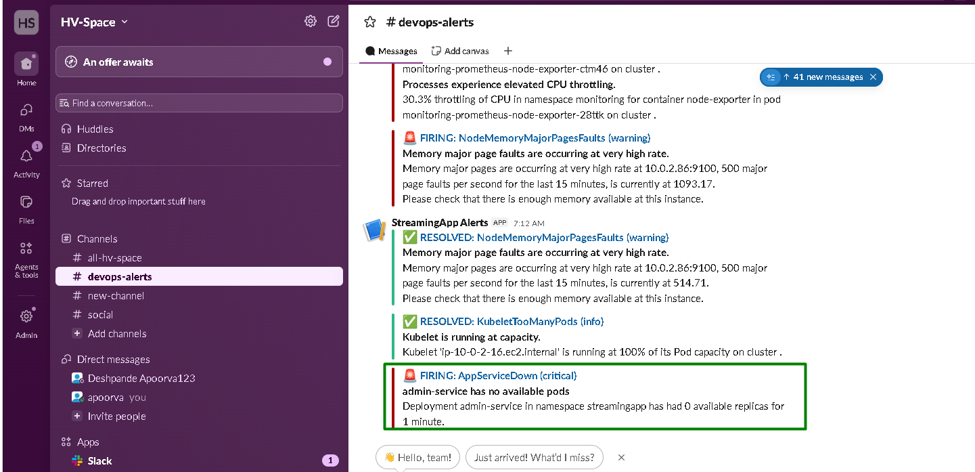

✅ The same alert is RESOLVED once the service is scaled back up:

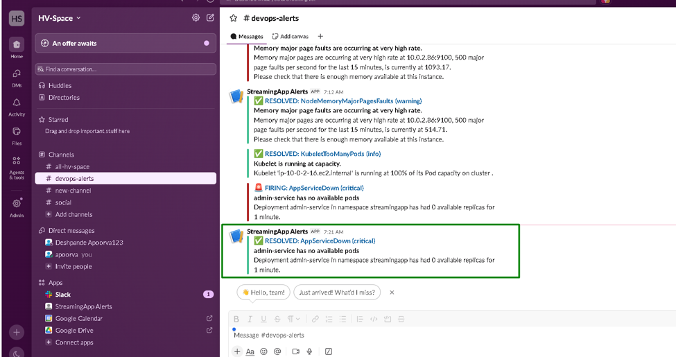

**Failed deployment notifications, tested with a deliberately failing unit test:** Jenkins posts ❌ "Build #7 on Sprint-3 FAILED" with the build link, and Prometheus fires 🚨 `JenkinsJobFailed (warning)` for the same job:

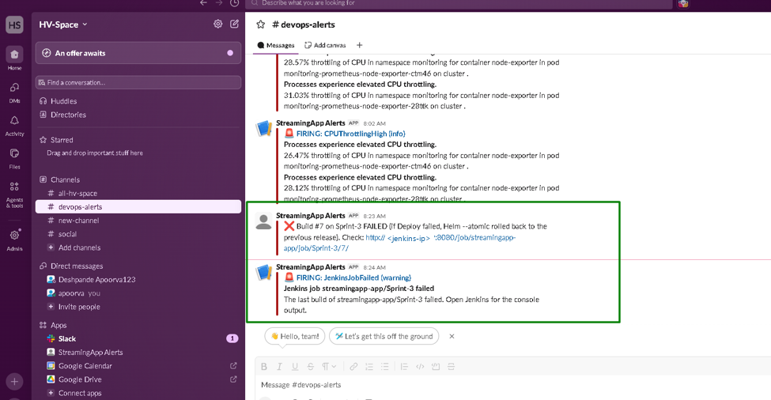

---

## Sprint 6: Testing, documentation and final automation

**Goal:** automated tests at every level, a fully automated trigger chain, and complete documentation.

| Test suite | What it checks | Runs in |
|---|---|---|
| Unit tests (Jest) | 4 backend services and the React frontend | app: Unit Tests |
| `tests/monitoring/run-rule-tests.sh` | Alert rule syntax and promtool unit tests | ansible: Test alert rules |
| `tests/infra/verify-infra.sh` | EKS, nodes, subnets, NAT, security group, IAM, S3, state backend, ECR | ansible: Verify infrastructure |
| `tests/monitoring/verify-monitoring.sh` | Monitoring pods, scrape targets, rule groups, Alertmanager, Grafana | ansible + app: Monitoring Check |
| `tests/deployment/verify-deployment.sh` | Rollouts, image tag = commit, probes, HPAs, health and metrics endpoints | app: Deployment Tests |
| `tests/api/api-tests.sh` | Through the ALB: register, login, JWT, access control, video catalogue | app: API Tests |

Each script prints PASS / FAIL per check and exits non-zero on any failure. That turns the Jenkins stage red and sends a Slack alert.

- **Automated triggers:** code push → build → deploy → test, and infra apply → Ansible → app deploy → test.
- **Documentation:** the [Execution Runbook](docs/RUNBOOK.md) covers every phase, verification and troubleshooting. Test details are in [`tests/README.md`](tests/README.md).

**`streamingapp-app` #9 API Tests stage against the live EKS deployment: frontend, auth, access control and streaming (through MongoDB) checks, `Result: 18 passed, 0 failed`:**

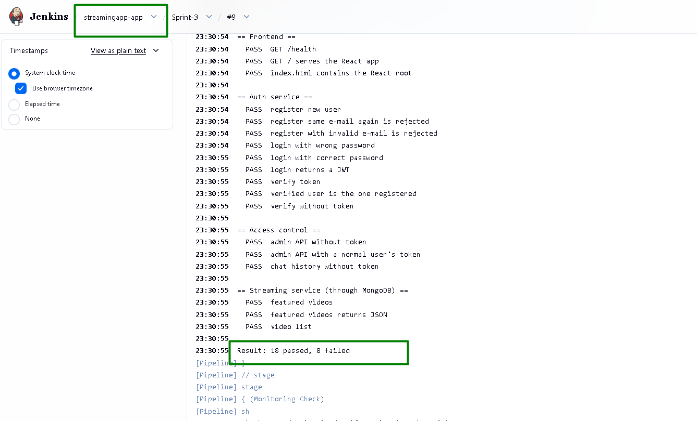

**The full chain from one click: `streamingapp-app` Sprint-3 #11 was started by `streamingapp-ansible` #4, which was started by `streamingapp-infra` #6, which was started manually. Provision → configure → deploy and test, with no further input:**

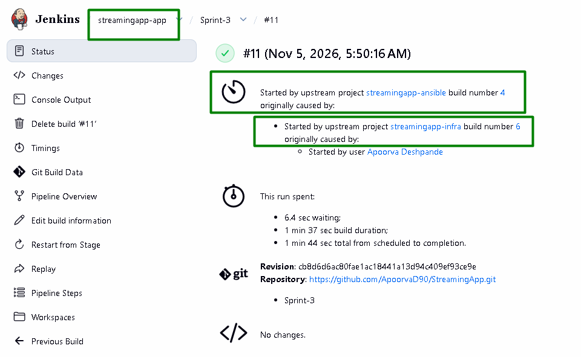

---

## Security and reproducibility

- **No secrets in code:** Jenkins uses an IAM role, the account ID is looked up at runtime, and secrets live in Jenkins credentials and Kubernetes Secrets.
- **Restricted access:** `admin_cidr` has no default and must be a single `/32`. The EKS public API and Jenkins are open only to it (plus GitHub's webhook ranges for Jenkins).
- **Pinned versions:** images are tagged with the git SHA (never `latest`), and ECR tags are immutable. EKS add-ons, the AMI, tools and Helm charts all use exact versions.

## Cost and teardown

Running on the AWS Free plan: about **$7.20/day** fully running, ~$4.35/day paused. Cost choices: Spot nodes, one NAT gateway, Grafana and Prometheus through `kubectl port-forward` instead of extra load balancers, and short metric retention. Everything is destroyed after evidence capture ([Runbook Phase 9](docs/RUNBOOK.md#phase-9--teardown-after-screenshots)).

---

## Repository structure

```
StreamingApp/
├── Jenkinsfile                # App CI/CD (Multibranch)
├── jenkins/
│   ├── Jenkinsfile.infra      # Terraform plan / approve / apply
│   └── Jenkinsfile.ansible    # Configuration, cluster bootstrap, verification
├── docker-compose.yml         # Local stack
├── frontend/                  # React + Nginx
├── backend/                   # auth, streaming, admin, chat services
├── k8s/                       # Namespace, MongoDB, Ingress, monitoring values, alert rules, dashboards
├── helm/                      # streamingapp chart + production values
├── terraform/                 # VPC, EKS, EC2, ECR, S3, IAM, security groups
├── ansible/                   # site.yml, k8s-bootstrap.yml, roles
├── tests/                     # infra, deployment, API and monitoring tests
└── docs/                      # Runbook, presentations, reports, screenshots
```

## License

MIT © Apoorva Deshpande
